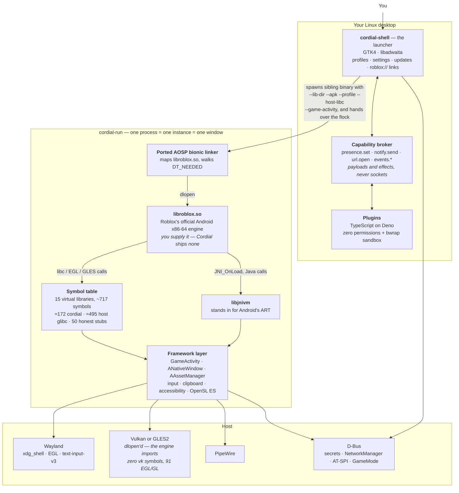

# How Cordial works

<!-- description: A map of Cordial's parts, and the rules that shape how it answers the Roblox engine. -->
<!-- icon: diagram-project -->

> [!NOTE]
> This is a map of the tree as it stands, not a specification. Where it and an
> ADR disagree, the ADR is the decision and this page is out of date; say so and
> fix it.

## The parts

| Part | What it is |
|---|---|
| **`cordial-shell`** | The launcher: GTK4 and libadwaita. Profiles, settings, updates, `roblox://` links |
| **Capability broker** | Holds plugin permissions and performs the effects: `presence.set`, `notify.send`, `url.open`, `events.*`. Payloads and effects, never sockets |
| **Plugins** | TypeScript on Deno, with zero permissions and a `bwrap` sandbox |
| **`cordial-run`** | One process, one instance, one window. Holds the engine and everything that answers it |
| **Ported AOSP bionic linker** | Maps `libroblox.so` and walks `DT_NEEDED` |
| **Symbol table** | 15 virtual libraries, about 717 symbols, answering every name the engine imports |
| **libjnivm** | Stands in for Android's ART |
| **Framework layer** | GameActivity, ANativeWindow, AAssetManager, input, clipboard, accessibility, OpenSL ES |
| **`libroblox.so`** | Roblox's official Android x86-64 engine. You supply it; Cordial ships none |

The shell spawns `cordial-run` as a sibling binary with `--lib-dir --apk
--profile --host-libc --game-activity`, and hands over the profile's `flock`.

## Rules that shape it

**Nothing points into the engine.** `libroblox.so` is mapped, relocated and
called, and that is all. Every arrow touching it points outward: the engine asks,
Cordial answers. There is no hooking, patching or injected script environment;
those are absent from the API, not disabled, so a fork has no primitive to
re-enable
([ADR-001](adr/ADR-001-in-process-hooking.md),
[ADR-003](adr/ADR-003-plugin-isolation.md)).

**Plugins never reach the engine side.** They talk to the broker, which holds the
permission and performs the effect; `presence.set` takes a presence structure and
Cordial owns the Discord socket
([ADR-007](adr/ADR-007-host-resources-are-brokered.md)). The `bwrap` layer under
Deno can only subtract
([ADR-018](adr/ADR-018-plugin-sub-sandboxing.md)).

**One process is one window is one profile.** A profile is storage; an instance
is a window. Several clients may run at once, but two on one profile are refused,
because two processes writing one `appData` and one cookie store corrupt Roblox's
storage ([ADR-012](adr/ADR-012-profiles-and-instances.md)).

**The engine's network stack is not touched.** Cordial does not proxy, inspect or
rewrite it: Roblox's cURL talks to Roblox directly, and `RtcIoRna`, the real-time
game transport, is not HTTP at all. That is why there is no `http_proxy`-shaped
setting and the per-profile VPN gate is a launch gate rather than a tunnel
([ADR-016](adr/ADR-016-per-profile-network-egress.md)).

## How the engine is answered

Every name the engine imports resolves one of three ways. The split is printed at
startup (172 Cordial, 495 host glibc, 50 stubs against Roblox 2.748.0.1527), so it
can be checked rather than assumed. It moves with the build and with what the host
offers: AAudio's 25 entries are registered only when it is the selected audio
backend, and Vulkan's two only when the host has a `libvulkan.so.1` to borrow
`vkGetInstanceProcAddr` from.

| Route | Meaning |
|---|---|
| **cordial** | Cordial implements it, because Android's version does something Linux's does not |
| **host** | Forwarded straight to the host's glibc (`--host-libc`) |
| **stub** | Not implemented, and it **reports failure** rather than faking success |

A stub that returns success sends the engine off on an answer that is not true,
and it fails somewhere unrelated. `native/opensles.cpp` returns
`SL_RESULT_FEATURE_UNSUPPORTED` instead of a dead engine object; that is the
pattern.

**The renderer is chosen by absence.** The engine imports zero Vulkan symbols and
91 EGL/GL ones, and picks its backend with `dlopen` at run time. Selecting GLES
means withholding the virtual `libvulkan` soname; there is no flag for it.
`FStringDebugGraphicsPreferredBackend` was measured to be inert and the code that
set it was deleted.
